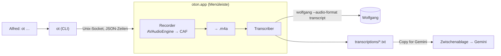

<p align="center">
  
</p>

<h1 align="center">oton</h1>

<p align="center">
  <b>Klick. Reden. Klick. Transkript.</b><br>
  Gespräche mit einem Klick in der Menüleiste aufnehmen, von <a href="https://github.com/k1tesurfen/wolfgang">Wolfgang</a> aufschreiben lassen<br>
  und mit fertigem Prompt an Gemini geben – Aufgaben, Entscheidungen, offene Fragen.<br>
  <sub>Für Macs mit Apple-Chip · macOS 14 oder neuer · Aufnahme und Transkription laufen komplett auf deinem Mac</sub>
</p>

<p align="center">
  <a href="https://github.com/k1tesurfen/oton/releases/latest/download/oton.dmg"></a>
</p>

<p align="center">
  <a href="https://github.com/k1tesurfen/oton/releases/latest"></a>
  <a href="https://github.com/k1tesurfen/oton/releases"></a>
  
  
  
  <a href="LICENSE"></a>
</p>

---

## Was oton macht

```
 ○  Klick  ──▶  ◉  Aufnahme läuft  ──▶  Klick  ──▶  Wolfgang schreibt auf  ──▶  🔔 „Copy for Gemini“  ──▶  ⌘V in Gemini
```

1. **Klick** aufs O in der Menüleiste: oton nimmt auf. Im O erscheint ein Punkt.
2. **Nochmal klicken**: Aufnahme fertig, Wolfgang schreibt sofort auf, was gesagt wurde.
3. **Mitteilung** „Transcript ready“ → **Copy for Gemini**: Prompt und Transkript liegen in der Zwischenablage.
4. In [Gemini](https://gemini.google.com/app) einfügen, Enter. Gemini liefert Kurzfassung, Aufgaben, Entscheidungen und offene Fragen – oder bei reinen Diskussionen eine ausführliche Zusammenfassung.

<p align="center">
  <br>
  <sub>bereit · nimmt auf · wartet auf ein Mikrofon · schreibt auf</sub>
</p>

**Nichts läuft heimlich.** oton nimmt nur auf, wenn du es startest. Solange es aufnimmt, zeigt macOS den orangen Mikrofon-Punkt und oton den Punkt im O. Mit der Maus übers O fahren zeigt, wie lange schon.

---

## Installieren

<p>
  <a href="https://github.com/k1tesurfen/oton/releases/latest/download/oton.dmg"></a>
</p>

1. `oton.dmg` laden, öffnen und **oton** in den **Programme**-Ordner ziehen.
2. oton aus dem Programme-Ordner starten (siehe [Der erste Start](#der-erste-start)).
3. macOS fragt nach **Mikrofon** und **Mitteilungen**: beides erlauben. Ohne Mitteilungen gibt's keinen „Copy for Gemini“-Knopf.
4. Fertig. oton startet ab jetzt bei der Anmeldung mit (abschaltbar: Rechtsklick → Setup → Open at login).

### Der erste Start

oton ist nicht von Apple beglaubigt (kein Apple-Entwicklerkonto). macOS sagt deshalb beim ersten Start etwas wie „oton kann nicht geöffnet werden, da Apple nicht überprüfen kann …“. Kein Grund zur Sorge:

1. Den Hinweis mit **Fertig** schließen.
2. **Systemeinstellungen → Datenschutz & Sicherheit** öffnen und ganz nach unten scrollen.
3. Bei „oton wurde blockiert …“ auf **Dennoch öffnen** klicken und bestätigen.

Das ist nur einmal nötig. Wer's lieber im Terminal mag:

```bash
xattr -dr com.apple.quarantine /Applications/oton.app
```

### Wolfgang (fürs Aufschreiben)

oton nimmt auf, **Wolfgang schreibt auf**. Einmal einrichten:

1. [Wolfgang installieren](https://github.com/k1tesurfen/wolfgang/releases/latest).
2. In Wolfgang auf den **Computer** klicken → Zusatzmodul fürs Aufschreiben laden (≈ 575 MB).
3. Auf **Wolfgang selbst** klicken → Kommandozeile **Installieren**. oton ruft `/usr/local/bin/wolfgang` auf.

Fehlt etwas davon, zeigt oton im Menü „⚠︎ Get Wolfgang“.

### Neue Versionen

Neue `oton.dmg` laden und oton im Programme-Ordner ersetzen. Mikrofon-Erlaubnis und Einstellungen bleiben.

---

## Bedienung

| Menüleiste | Alfred | Terminal | |
|---|---|---|---|
| **Klick** aufs O | `ot start` | `ot start` | Aufnahme starten |
| **Klick** aufs O mit Punkt | `ot stop` | `ot stop` | stoppen → aufschreiben → Mitteilung |
| Mitteilung → **Copy for Gemini** | `ot copy` (⌘↩ öffnet Gemini) | `ot copy [--open]` | Prompt + neuestes Transkript in die Zwischenablage |
| Rechtsklick → Recent transcriptions | `ot list` (↩ mit Prompt, ⌘↩ ohne) | `ot list`, `ot copy 3` | ältere Transkripte |
| Rechtsklick → Microphone | `ot mic` | `ot mic`, `ot mic brio` | Mikrofon wählen |
| Maus übers O | `ot` | `ot` | Status: läuft? wie lange? welches Mikrofon? |

**Rechtsklick** (oder ⌃/⌥-Klick) aufs O öffnet das Menü mit allem anderen: Ordner öffnen, Prompt bearbeiten, Setup, Beenden.

### Mikrofon

- oton **merkt sich dein Mikrofon**. Wählst du ein anderes, gilt das ab sofort – auch mitten in einer Aufnahme.
- Ist dein Mikrofon nicht angeschlossen, nimmt oton das zuletzt davor gewählte, sonst irgendein USB-Mikrofon, sonst das eingebaute.
- **Deckel zu = nie das eingebaute Mikrofon.** Bei zugeklapptem MacBook nimmt es nur Stille auf. Wird der Deckel während der Aufnahme zugeklappt, wechselt oton aufs nächste Mikrofon.
- Bluetooth-Headsets und virtuelle Geräte (Teams Audio) nur, wenn du sie ausdrücklich wählst.
- Mikrofon abgezogen? oton macht mit dem nächsten weiter und sagt Bescheid.

### Alfred & Terminal (optional)

- **Alfred:** `oton.alfredworkflow` aus der DMG doppelklicken (oder Rechtsklick → Setup → Install Alfred workflow). Stichwort: **`ot`**.
- **Terminal:** Rechtsklick → Setup → Install command line tool `ot` (fragt nach dem Admin-Passwort). Dann `ot help`.

```console
$ ot start
recording on Brio 500
$ ot
● recording 12:34 since 10:40 on Brio 500
$ ot stop
stopped after 45:12; transcribing, you'll get a notification
$ ot copy --open
copied 10:40–11:25 (45m) with the prompt
```

Alles gibt's auch als JSON (`ot --json …`), eine Zeile pro Ereignis.

---

## Wo liegt was?

| | |
|---|---|
| `~/Documents/oton/recordings/26-11-26_1040-1125_45m_oton.m4a` | jede Aufnahme (AAC, 16 kHz mono, ≈ 15 MB pro Stunde) |
| `~/Documents/oton/transcriptions/26-11-26_1040-1125_45m_oton.txt` | das Transkript dazu (gleicher Name) |
| `~/Library/Application Support/oton/prompt.md` | der Gemini-Prompt – anpassen über Rechtsklick → Edit prompt… |
| `~/Library/Application Support/oton/settings.json` | Mikrofon-Reihenfolge, Wolfgang-Pfad, Gemini-Adresse |

oton löscht nichts von selbst. Aufräumen ist deine Sache.

**Datenschutz:** Aufnahme und Transkription laufen komplett auf deinem Mac, nichts geht ins Internet. Erst wenn du das Transkript in Gemini einfügst, verlässt es den Rechner. Das Transkript hat keine Sprecherzuordnung. Wer andere aufnimmt, fragt vorher.

---

## Für Entwickler

<details>
<summary><b>Bauen, testen, veröffentlichen</b></summary>

Nur die Command Line Tools nötig (kein Xcode), Swift 6, `rsvg-convert` (`brew install librsvg`) für Symbol und DMG.

```sh
scripts/make-cert.sh        # einmal: selbst signiertes Zertifikat "oton Local" im Schlüsselbund
make test                   # Unit-Tests + ein echter Durchlauf durch Wolfgang (~30 s, immer frisch gebaut)
make install                # bauen, signieren, nach /Applications, starten
make dmg                    # build/oton.dmg
make release VERSION=0.3.0  # testen, DMG, Tag, Push, GitHub-Release (Notizen: docs/release-notes/0.3.0.md)

swift build && OTON_DEV_ROOT=/tmp/o .build/debug/oton   # ungebündelt mit eigenem Datenordner
OTON_DEV_ROOT=/tmp/o .build/debug/ot start
```

Das DMG-Fensterlayout liegt fertig in `Resources/dmg/DS_Store`; `make dmg` braucht den Finder nicht. Nach Änderungen an `Resources/dmg/background.svg` einmal `scripts/make-dmg.sh --layout build/oton.app build/oton.dmg` (öffnet kurz ein Finder-Fenster).

**Signieren ohne Apple-Konto:** Alle Versionen werden mit demselben selbst signierten Zertifikat signiert. macOS bindet die Mikrofon-Erlaubnis an dieses Zertifikat, deshalb bleibt sie bei Updates erhalten. Gatekeeper braucht trotzdem einmal „Dennoch öffnen“.

</details>

<details>
<summary><b>Aufbau</b></summary>



- **Nur die App nimmt auf.** macOS bindet die Mikrofon-Erlaubnis an die App; `ot` und Alfred schicken nur Befehle über einen Unix-Socket (`0600`, nur der eigene Benutzer).
- **Absturzsicher:** Während der Aufnahme schreibt oton eine CAF-Datei, die auch abgeschnitten lesbar bleibt. Nach einem Absturz wird sie beim nächsten Start fertig gemacht und aufgeschrieben.
- **Segmente:** Mikrofonwechsel, Ruhezustand und abgezogene Mikrofone werden festgehalten; das Transkript bekommt echte Uhrzeiten (`[10:40]`) und Lücken (`[gap 10:52–11:05, sleep]`).

Entscheidungen und Begründungen: [CONCEPT.md](CONCEPT.md).

</details>

---

<p align="center"><sub><a href="LICENSE">Apache 2.0</a></sub></p>
